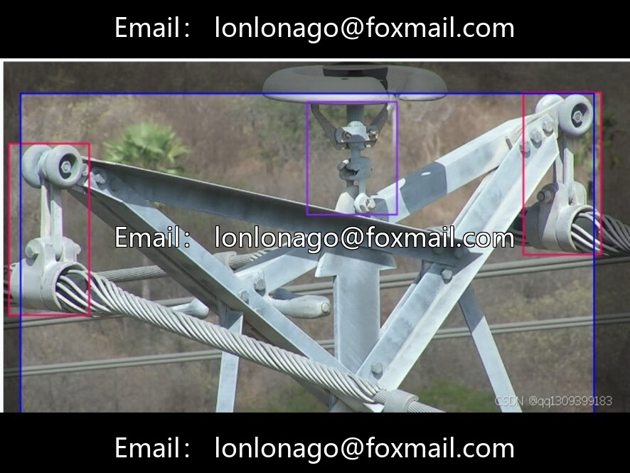
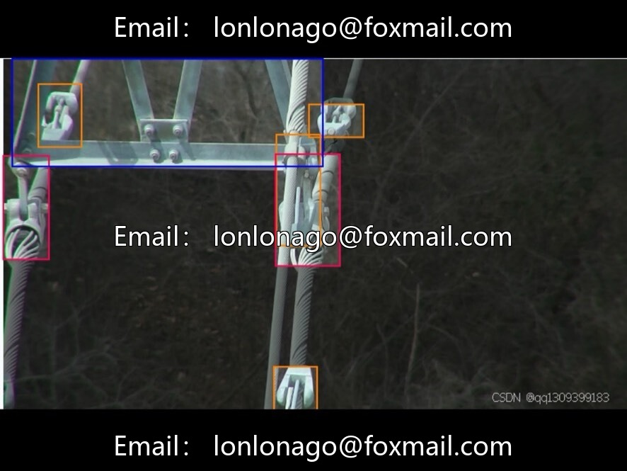
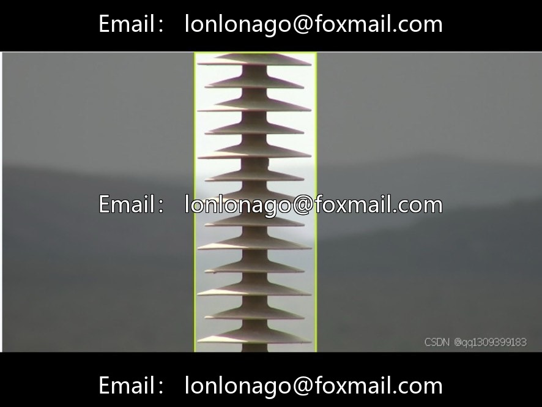
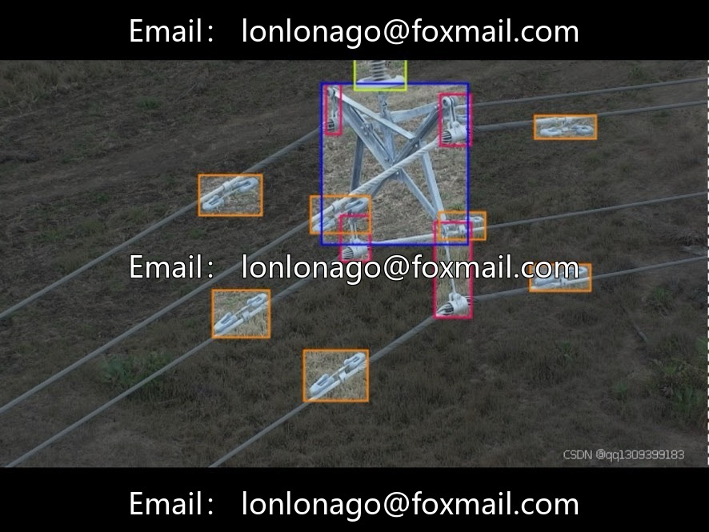
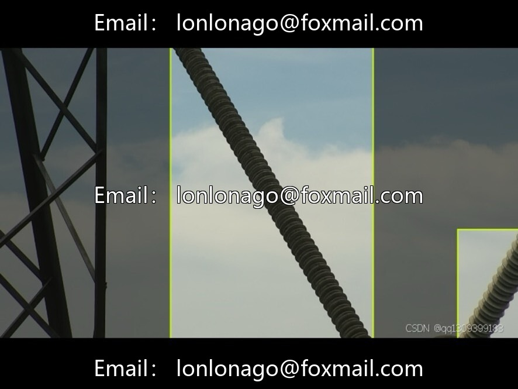

# Drone Power Components Inspection Data Set, Issue 10006, Compatible with Deep Learning & Electricity

## Body

Drone Power Components Inspection Dataset, Issue 10006, Compatible with Deep Learning & Electric Power AI practitioners, 9400 training images, target detection task, divided into 38 categories, device + defect binary structure.

Comprises a comprehensive range of electrical components including cables, poles, transformers, insulators, dampers, lightning arresters, fuses, and spaced rods. Common defects include cable breaks, insulator damage, hanging device failures, clamp malfunctions, and equipment damage. Special categories include bird's nests, line vegetation, and pole signage. Some components retain their English names for precise labeling.

The dataset supports fully automatic inspections for drones and inspection robots, addressing issues such as high-altitude risks, terrain limitations, and inconsistencies in standards. It autonomously locates towers, investigates vegetation hazards, identifies equipment faults, and assists maintenance personnel with quick spare parts availability, increasing the fault detection rate by about 40% and reducing processing time by 30%.

Classification closely aligns with real-world scenarios, high degree of granularity, supports secondary development, adds defect level tags, expands device categories, and is open-source for industry collaboration, algorithm optimization, and enterprise implementation, aiding in the upgrade of smart grids.

Virtual materials, once sold, are non-refundable.
Interested friends, click "I want" to proceed.

## Images

## Payment

Here is a pay link on Stripe ( https://buy.stripe.com/3cs8yP7sY87d0vu9AB ). Please contact me lonlonago@foxmail.com after funding $89, and I will send you a complete data files , thank you!

